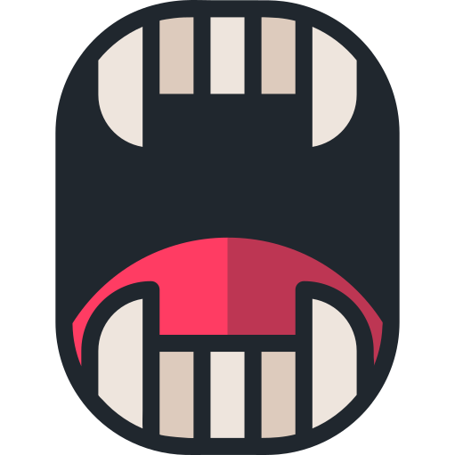

<div align="center">
  
  <h1>Arkada</h1>
  <p><strong>Aplicativo Android open-source de acompanhamento e rotina de higiene bucal</strong></p>

  <p>
    <a href="./LICENSE"></a>
    
    
    
    
  </p>
</div>

---

## Sobre o Projeto

O **Arkada** é um aplicativo mobile híbrido (focado em Android e Web/PWA) projetado para ajudar você a construir e manter o hábito diário de higiene bucal completa. Desenvolvido com **Flat Design estrito**, funcionamento **100% offline** e foco em privacidade (todos os dados ficam salvos localmente no seu dispositivo).

---

## Principais Funcionalidades

- **Onboarding Personalizado:** Escolha de `1` a `5` escovações diárias (padrão `3`), configure os horários exatos e defina em quais escovações deseja utilizar **Fio Dental** e **Enxaguante Bucal**.
- **Sistema de Sequência (Streak Estilo Duolingo):**
  - Contabiliza os dias consecutivos em que você atinge **100% da sua meta diária**.
  - Barra semanal minimalista (`Seg` a `Dom`) destacando os dias concluídos, parciais e pendentes.
  - Validação automática na virada do dia e ao retornar o aplicativo para o primeiro plano.
- **Lista de Escovações do Dia + Marcação Manual:**
  - Visualize todas as escovações programadas para hoje (*Concluída*, *Próxima*, *Pendente*) com indicadores das etapas configuradas (`+ Fio Dental`, `+ Enxaguante`).
  - **Marcação Rápida:** Escovou os dentes sem estar com o celular em mãos? Marque a escovação diretamente na lista até o final do dia para registrar no histórico e manter sua sequência ativa.
- **Sessão Guiada em Modo Foco:**
  1. **Etapa de Fio Dental (configurável por escovação):** Ilustração flat e guia rápido em 3 passos objetivos (formato em "C", movimento suave até a gengiva e trecho limpo por dente).
  2. **Timer Interativo de Escovação + Higienização da Língua:** Cronômetro circular SVG flat (configurável de **2 a 5 minutos**, padrão **3 minutos**) que divide o tempo entre os **4 quadrantes dentários** (*Superior Direito*, *Superior Esquerdo*, *Inferior Esquerdo*, *Inferior Direito*) e a **5ª etapa de Higienização da Língua** (da base até a ponta), disparando feedback tátil (`Haptics`) a cada troca de região.
  3. **Etapa de Enxaguante Bucal (configurável por escovação):** Orientações práticas para bochecho e preservação do flúor por 30 minutos.
- **Lembretes Diários Nativos & Small Badge no Ícone:**
  - Agendamento de notificações locais diárias recorrentes via `@capacitor/local-notifications`.
  - Exibição de **badge/ponto de notificação** no ícone do app quando há uma escovação cujo horário já chegou e ainda está pendente, limpando automaticamente ao concluir.
- **Dicas Dinâmicas de Saúde Bucal:**
  - Banco local com 27 dicas odontológicas práticas sorteadas sem repetição sempre que você volta para a tela inicial ou reabre o aplicativo.

---

## Stack Tecnológica

| Camada | Tecnologia |
| :--- | :--- |
| **Core Frontend** | React 18 + TypeScript + Vite |
| **Estilização & UI** | Tailwind CSS (Flat Design estrito, Light Mode) + `lucide-react` |
| **Runtime Nativo** | Capacitor 6 (`@capacitor/core`, `@capacitor/android`) |
| **Notificações & Badge** | `@capacitor/local-notifications` + `@capawesome/capacitor-badge` |
| **Feedback Tátil** | `@capacitor/haptics` (com fallback Web `navigator.vibrate`) |
| **Persistência Local** | `@capacitor/preferences` (`SharedPreferences` no Android + espelhamento em `localStorage`) |
| **Ciclo de Vida** | `@capacitor/app` (`appStateChange` + `visibilitychange`) |

---

## Estrutura do Projeto

```text
arkada/
├── android/                  # Projeto nativo Android (Capacitor)
├── public/                   # Ícones públicos, favicon e manifest PWA
├── resources/                # Recursos base de ícone do app
├── src/
│   ├── assets/               # Logo e ícones SVG/PNG do Arkada
│   ├── components/           # Componentes Flat UI reutilizáveis
│   │   ├── Button.tsx
│   │   ├── Card.tsx
│   │   ├── CircularTimer.tsx
│   │   ├── ConfirmExitDialog.tsx
│   │   ├── Header.tsx
│   │   ├── StepIllustrations.tsx
│   │   ├── StreakBanner.tsx
│   │   └── Switch.tsx
│   ├── context/              # ArkadaContext (Estado global e regras de negócio)
│   ├── data/                 # Banco de dicas odontológicas (tips.ts)
│   ├── hooks/                # Hook customizado useArkadaStore
│   ├── pages/                # Telas principais (Onboarding, Home, Session, Settings)
│   ├── services/             # Integrações encapsuladas (storage, notifications, haptics)
│   └── types/                # Interfaces TypeScript
├── capacitor.config.ts       # Configuração do Capacitor (com.arkada.app)
├── package.json
└── tailwind.config.js
```

---

## Como Executar Localmente

### Pré-requisitos
- **Node.js** 18+ e **npm**
- Para compilar o APK Android: **JDK 17 ou 21** e **Android SDK** (via Android Studio ou Command Line Tools)

### 1. Clonar e instalar dependências
```bash
git clone https://github.com/GabeVoid/arkada.git
cd arkada
npm install
```

### 2. Rodar no navegador (Modo Desenvolvimento)
```bash
npm run dev
```

### 3. Sincronizar e gerar o APK Android
Para compilar o bundle de produção, sincronizar com o Capacitor e gerar o APK de instalação diretamente pelo terminal:
```bash
npm run apk:debug
```
O arquivo `.apk` será gerado em:
```text
android/app/build/outputs/apk/debug/app-debug.apk
```

Ou, se preferir abrir no **Android Studio**:
```bash
npm run android:build
npm run cap:open
```

---

## Download Direto (APK)

Você pode baixar a versão mais recente do APK diretamente na aba [**Releases**](https://github.com/GabeVoid/arkada/releases) deste repositório e instalá-la no seu dispositivo Android.

> **Dica de Atualização:** Ao instalar uma versão nova do APK sobre uma versão anterior já instalada no aparelho, **não desinstale a versão antiga antes** — instale por cima para que todas as suas configurações, horários e sequência (streak) permaneçam salvos.

---

## Como Contribuir

Contribuições são muito bem-vindas! Confira o guia em [CONTRIBUTING.md](./CONTRIBUTING.md) para saber como abrir *issues*, sugerir novas dicas odontológicas ou enviar *pull requests*.

---

## Aviso Legal

O **Arkada** é uma ferramenta educativa e de acompanhamento de rotina de higiene bucal e **não substitui** a avaliação, o diagnóstico ou o tratamento realizado por um cirurgião-dentista. Visite seu dentista regularmente.

---

## Licença

Distribuído sob a licença **MIT**. Veja o arquivo [LICENSE](./LICENSE) para mais detalhes.
